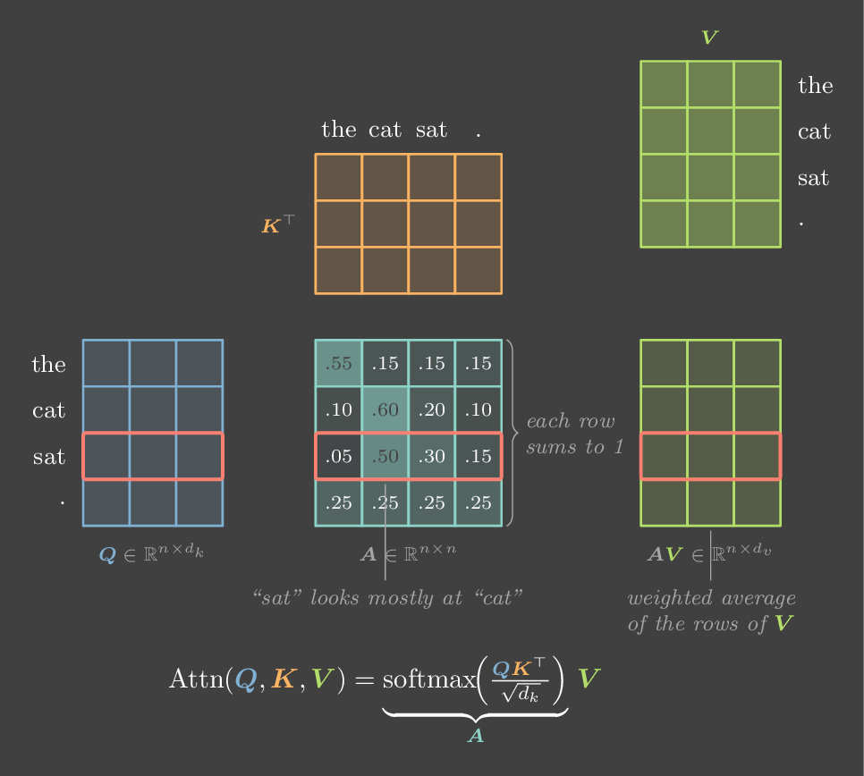
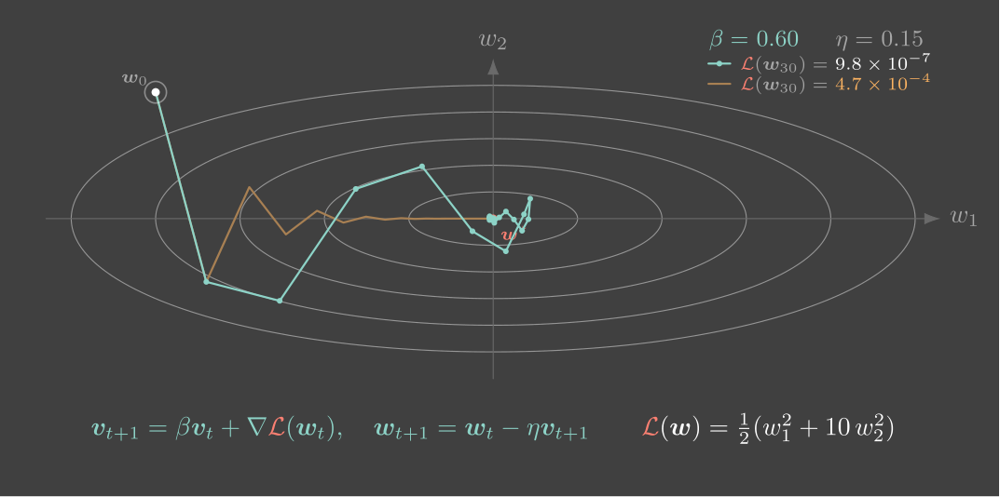

# TikZ skills

Three agent skills for explaining deep-learning ideas with figures. They share
one visual language (`dlviz.sty`: colour means role, standard DL notation, a
look inspired by Alfredo Canziani's NYU Deep Learning course) and are meant to
be installed together.

| Skill | Makes | Use it for |
| --- | --- | --- |
| [`tikz-dl-visualizer`](skills/tikz-dl-visualizer) | A static TikZ/pgfplots figure (PDF + PNG) and a short guide to reading it | Slides, papers, theses, handouts, lecture notes |
| [`tikz-live`](skills/tikz-live) | An interactive figure: drag points, move sliders, hover rows, play steps. Every static label stays real LaTeX | Web pages, blogs, course notes, artifacts |
| [`tikz-explorer-book`](skills/tikz-explorer-book) | A one-page web book: an interactive concept map with a guided tour, then chapters built around computed figures | Courses, syllabi, reading lists, "show me the big picture of X" |

`tikz-explorer-book` builds its figures with the other two, so install all three.

<p align="center">
  
  
</p>

## Install

**Claude Code plugin**

```
/plugin marketplace add szcharlesji/tikz-skills
/plugin install tikz-skills@tikz-skills
```

**Any agent that reads skills folders** (Claude Code, Codex, Cursor and others), with the [skills CLI](https://github.com/vercel-labs/skills):

```
npx skills add szcharlesji/tikz-skills
```

**By hand:** copy the three folders in [`skills/`](skills) into your agent's
skills folder (for Claude Code, `~/.claude/skills/`). Keep them next to each
other: `tikz-explorer-book` finds the other two as sibling folders.

## Requirements

- A TeX install with TikZ, pgfplots and `standalone` (`pdflatex`)
- Ghostscript or poppler, to turn PDFs into PNGs
- ImageMagick (`magick`), for contact sheets and zoomed crops
- [`uv`](https://docs.astral.sh/uv/) (or Python with numpy/scipy), for the numbers behind each figure
- For live figures: `node` and PyMuPDF (`uv run --with pymupdf`)

Check with `which pdflatex gs magick uv node`. If a TeX package is missing,
the skills tell you the `tlmgr install` command rather than installing it.

## Usage

Ask in plain words; the skills trigger on their own:

- "Draw a figure explaining layer norm vs batch norm for my slides"
- "Make an interactive version of the momentum figure where I can drag the start point"
- "Make an illustrated explorer book for this syllabus" (attach or paste it)

## License

[MIT](LICENSE)
